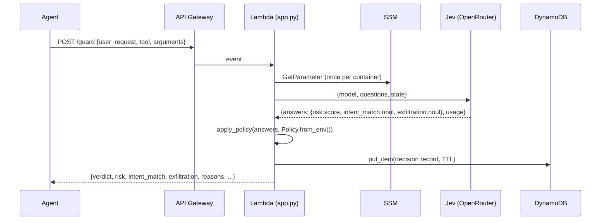

# Design: Jev Agent Guardrail

## Overview

A single Lambda behind an HTTP API. The Lambda validates input, builds a small factual state object, sends it with three fixed typed questions to Jev via OpenRouter, applies a pure threshold policy, logs the result to DynamoDB, and returns the verdict.

## Architecture

## Components

### `src/guardrail.py` (stdlib only)
- `QUESTIONS`: the three Jev questions. Score criteria ordered safe -> dangerous so `score` maps 0..2.
- `Policy` dataclass with `from_env()`.
- `build_state()`: user_request + proposed_tool_call + optional agent_context. Nothing else.
- `call_jev()`: urllib POST, 5s timeout, raises `RuntimeError` on HTTP error.
- `apply_policy(answers, policy) -> (verdict, reasons)`: pure.
- `decide(...)`: orchestrates, accepts `jev_caller` injection for tests, measures latency, reads `usage.cost`.

### `src/app.py` (Lambda)
- Module-level boto3 clients, SSM key cache.
- Validation -> `decide` -> `_to_ddb` -> `put_item` -> JSON response.
- Any exception in `decide` -> 502 with `verdict: ask`.

### `template.yaml`
- `AWS::Serverless::HttpApi` with CORS.
- `AWS::Serverless::Function`, python3.12, arm64, 256 MB, 15s.
- `AWS::DynamoDB::Table`, on-demand, TTL on `expires_at`, GSI `by-session`.
- Parameters: SSM parameter name, Jev model id.

## Data model

DynamoDB item:

| Attribute | Type | Notes |
|---|---|---|
| decision_id | S | uuid4, partition key |
| session_id | S | GSI hash, "none" if absent |
| created_at | N | epoch seconds, GSI range |
| expires_at | N | TTL |
| user_request, tool, arguments | S | truncated |
| verdict | S | allow / ask / block |
| risk, intent_match, exfiltration, jev_cost_usd | N (Decimal) | |
| reasons | L | strings |
| jev_model | S | dated snapshot from response |
| latency_ms | N | |

## Policy decision table

See requirements 3.2 to 3.6. Order of evaluation: exfiltration block, intent block, risk+weak-intent block, then ask conditions, then allow.

## Error handling

- Bad input: 400.
- Jev / SSM / network failure: 502, `verdict: ask`. Never 200 with allow on failure.
- DynamoDB write failure: propagates as 500 from Lambda. Acceptable for v1; a future version could return the verdict and log asynchronously.

## Testing strategy

- `tests/test_policy.py`: every branch of `apply_policy`, `Policy.from_env`, `build_state` shape, `decide` with injected caller.
- `tests/test_handler.py`: stub `boto3` in `sys.modules`, cover 400s, happy path (item written, Decimal conversion, TTL), fail-closed path.
- No test performs network I/O.

## Security

- Key in SSM SecureString, least-privilege IAM.
- Endpoint is unauthenticated in v1 for demo purposes. Documented in README. Production: IAM authorizer or Lambda authorizer.
- State sent to Jev is user-controlled text. Jev cannot execute instructions found in state, which is the point of using a System One model here.
