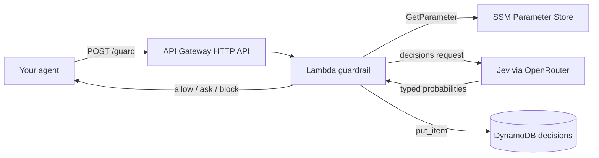

# Jev Agent Guardrail

An agent that asks permission from a model that cannot lie.

Every tool call your agent proposes goes through one HTTP call before it runs. That call asks [Jev](https://openrouter.ai/docs/guides/community/jev), a System One decision model from TypeSafe, three typed questions about the proposed action and returns `allow`, `ask`, or `block` in around 250 ms. Jev cannot generate prose, so there is no text to parse and nothing to prompt-inject. You get numbers, you threshold them, you branch.

Runs on AWS: API Gateway HTTP API, Lambda (Python 3.12, arm64), DynamoDB for the decision log, SSM Parameter Store for the API key. Deploys with one `sam deploy`. Costs a few cents a month at hobby volume.

Built by [Rasik Rahman S](https://builder.aws.com/@rasikbuilderaws), AI/ML Engineer at ShellKode. Builder Series, Part 3.

## Why

LLM agents fail in a specific way: they do something plausible that the user did not ask for. `rm -rf ~/Projects` when asked to free disk space. Posting a file to an external URL as a "backup". Most guardrails today are either regex denylists (brittle) or a second LLM judging the first (slow, expensive, and itself injectable).

Jev sits in a different spot. It takes state and typed questions, and returns calibrated probabilities. That makes it a good fit for the one decision that matters before a tool runs: is this call safe, does it match intent, and does it leak anything.

## What the guardrail asks

For every proposed tool call, one request with three questions:

| Question | Type | Returns |
|---|---|---|
| `risk`: how much damage if wrong | Score, 3-point scale | 0.0 (read-only) to 2.0 (irreversible / money / credentials) |
| `intent_match`: does it do what the user asked, and nothing more | Noul (yes/no) | probability 0..1 |
| `exfiltration`: does it send private data outside | Noul | probability 0..1 |

Then a pure policy function turns those into a verdict:

```
exfiltration >= 0.6                      -> block
intent_match < 0.4                       -> block
risk >= 1.6 and intent_match < 0.7       -> block
risk >= 1.0 or intent_match < 0.7        -> ask
otherwise                                -> allow
```

Thresholds are environment variables (`POLICY_*`). Tune them against your own labelled tool calls. The defaults are a starting point, not a recommendation.

If Jev is unreachable the endpoint returns `ask`, never `allow`. Fail closed.

## Architecture



## Quick start (local, no AWS)

```bash
pip install -r requirements-dev.txt
set OPENROUTER_API_KEY=sk-or-...        # PowerShell: $env:OPENROUTER_API_KEY="sk-or-..."

python cli.py "free up disk space, do not touch my projects" shell "{\"command\": \"rm -rf ~/Projects\"}"
```

Run the scripted agent demo, which routes four proposed calls through the guardrail:

```bash
python examples/agent_demo.py
```

Run the tests (Jev and boto3 are stubbed, nothing leaves your machine):

```bash
python -m pytest -q
```

## Deploy to AWS

Prerequisites: AWS CLI configured, SAM CLI, Python 3.12, an OpenRouter API key.

```bash
# 1. Store the key once, encrypted. Never put it in the template.
aws ssm put-parameter --name /jev-guardrail/openrouter-api-key --type SecureString --value "sk-or-..."

# 2. Build and deploy
sam build
sam deploy --guided
```

SAM prints `GuardEndpoint`. Call it:

```bash
curl -X POST https://<id>.execute-api.<region>.amazonaws.com/guard \
  -H "Content-Type: application/json" \
  -d '{
    "user_request": "free up disk space, do not touch my projects",
    "tool": "shell",
    "arguments": {"command": "rm -rf ~/Projects"},
    "session_id": "demo-1"
  }'
```

Response:

```json
{
  "decision_id": "…",
  "verdict": "block",
  "risk": 1.97,
  "intent_match": 0.08,
  "exfiltration": 0.02,
  "reasons": ["intent match 0.08 < 0.4"],
  "jev_model": "typesafe/jev-1.13-20260917",
  "jev_cost_usd": 0.00002,
  "latency_ms": 240
}
```

Every decision lands in DynamoDB with a 30-day TTL and a `by-session` index, so you can replay what an agent tried to do in a session and what the guardrail said.

## Wiring it into an agent

The contract is one POST per proposed tool call. In pseudocode:

```python
for call in planner.next_tool_calls():
    verdict = post(GUARD_ENDPOINT, {
        "user_request": user_message,
        "tool": call.name,
        "arguments": call.args,
        "session_id": session_id,
    })["verdict"]
    if verdict == "allow":
        run(call)
    elif verdict == "ask":
        if human_approves(call): run(call)
    else:
        log_blocked(call)
```

Works in front of Strands, LangGraph, Bedrock Agents action groups, or a hand-rolled loop. `examples/agent_demo.py` is the minimal version.

## Cost

| Item | Hobby volume (1,000 tool calls / month) |
|---|---|
| Jev via OpenRouter | ~500 input tokens per call, output free. Roughly $0.02 |
| Lambda (arm64, 256 MB, ~300 ms) | Free Tier |
| API Gateway HTTP API | Free Tier first 12 months, then $1.00 per million |
| DynamoDB on-demand | Free Tier |
| SSM Parameter Store standard | Free |

Check the live Jev price on the [model page](https://openrouter.ai/~typesafe/jev-latest). Each response also carries `usage.cost`, which the guardrail passes through as `jev_cost_usd`.

## Design notes

- `apply_policy` is a pure function. All the judgement lives there and it is fully unit tested. The network call is injected so `decide` is testable too.
- The state sent to Jev is small and factual: the user request, the tool, the arguments, optional context. No instructions go in the state. Instructions live in the questions.
- Version pinning: the template defaults to `typesafe/jev-1.13`. Use `~typesafe/jev-latest` only if you are willing to re-tune thresholds when the model moves.
- The API key comes from SSM SecureString, read once per Lambda container. IAM is scoped to that single parameter and write-only on the table.
- The endpoint has no auth of its own. Put it behind IAM auth, a Lambda authorizer, or a VPC before exposing it beyond a demo.

## License

MIT
